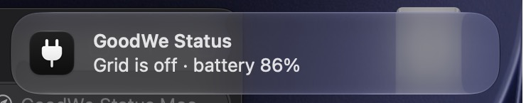
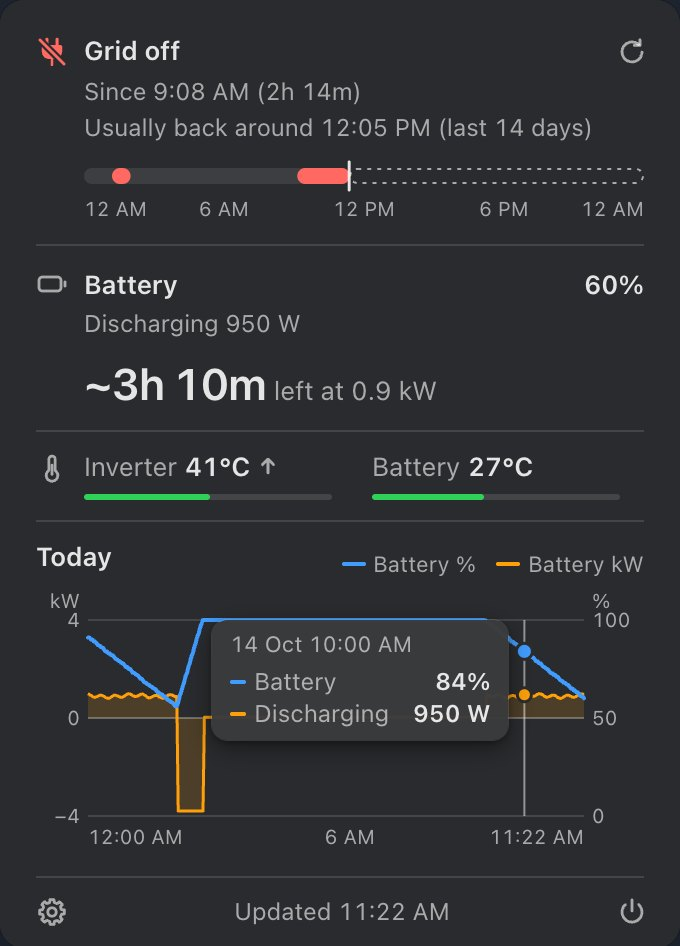
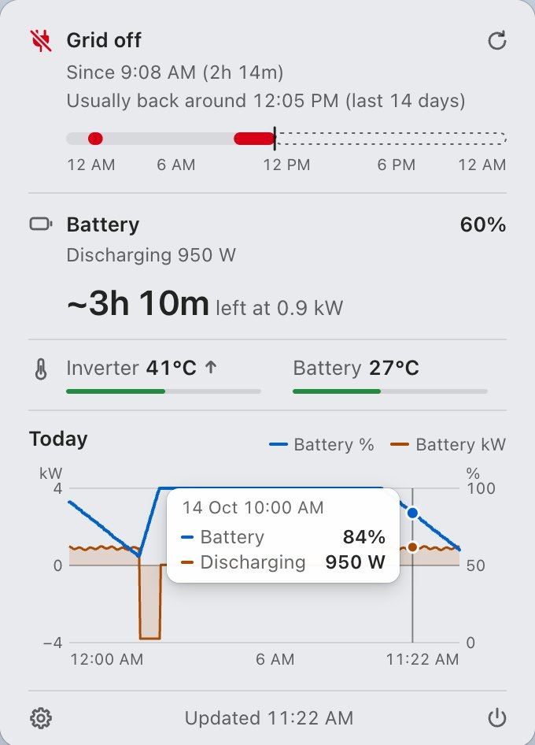
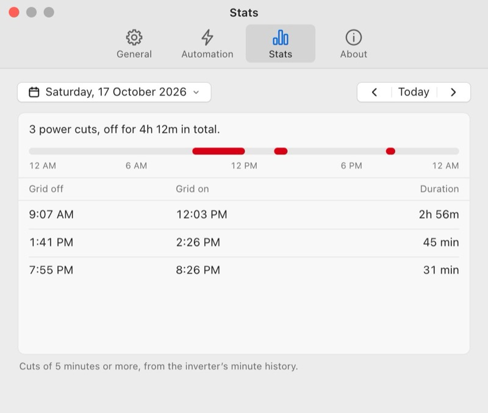
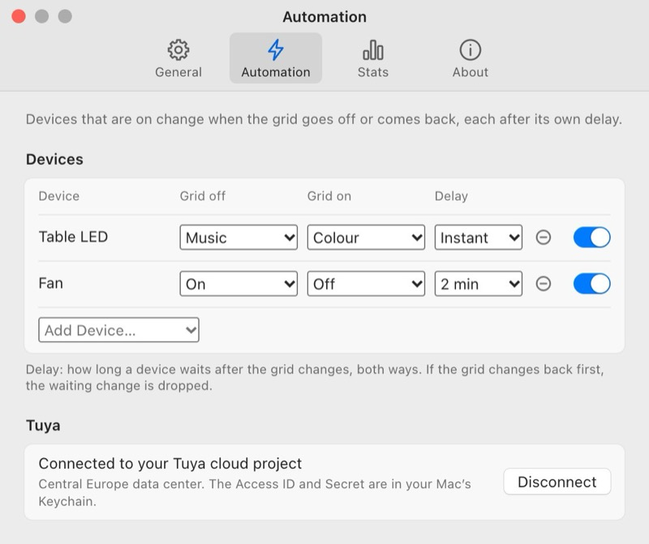

# GoodWe Status

A macOS menu bar app that shows your home battery level and whether the grid is on, from your GoodWe SEMS Portal account. Unofficial and not affiliated with GoodWe: it uses the same undocumented web endpoints as the SEMS apps, which can change at any time.

 

 

- **Grid off since** comes from the inverter's minute history, so it is right after a restart too.
- **Usually back around 12:05 PM (last 14 days)** while the grid is off, and **Next cut usually around 1:35 PM · back around 4:30 PM** while it is on. Both are estimates from the last 14 days, shown only when 3 of those days agree; never a promise. If that time passes and the grid is still off, the line stays until the grid comes back.
- **Today's power cuts:** a 24-hour strip under Grid shows today's cuts in red (point at one, or Tab, then ← →, to read it). Click the strip (or Tab to it and press Return) to open **Stats** on today. Hide it in **Settings › General › Show today's power cuts**.
- **Low battery alert:** while the grid is off, one alert with sound when the battery reaches 20% and one more at 10%. Change the level in **Settings › General › Low battery alert** (the second alert is always at half of it).
- **Temperatures:** the inverter's and the battery's, each with a bar on its scale. **Warm**, **Hot** or **Cold** shows next to a reading that isn't fine (inverter warm from 60 °C, hot from 70 °C; battery warm from 40 °C, hot from 50 °C, cold at 0 °C or below), and an arrow when it moved 2 °C or more in 30 minutes. Hide them in **Settings › General › Show temperatures**.
- **Chart:** point at it (or Tab, then ← →) to read the time, battery % and kW at that minute.
- **Refresh:** the ↻ button at the top right, or ⌘R. The panel stays open while it refreshes.
- **Settings** (the gear at the bottom left of the panel, ⌘,) holds Open at login, Show temperatures, Show today's power cuts, the low battery alert, the log folder, your account (Sign Out removes the saved login from your Keychain), the device automation below and Stats. Signed out, the panel also shows **Sign In…**. The power button at the bottom right quits (⌘Q), and between the two the panel says when it last got data (**Updated 9:45 AM**, or **No new data since …** when the readings stopped).
- **Stats:** **Settings › Stats** lists one day's power cuts: when the grid went off, when it came back and for how long, with a strip of the day above. ← / → (or ‹ ›) step a day, ⌘T goes to today, and the date button opens a calendar (a dot marks days with a cut).
- **Device automation:** Tuya / Smart Life devices can change by themselves when the grid goes off or comes back, each after its own delay. See [Device automation (Tuya)](#device-automation-tuya).

## Install

1. Download `GoodWe-Status-<version>-macos-arm64.zip` from the [latest release](https://github.com/asifshirazi/goodwe-status/releases/latest) (Apple silicon Macs), unzip it and move **GoodWe Status.app** to Applications. What changed in each version is in [CHANGELOG.md](CHANGELOG.md).
2. The app is not notarized, so the first time **right-click it, choose Open**, then **Open** again. (macOS 15+: try once, then **System Settings › Privacy & Security › Open Anyway**. Or: `xattr -dr com.apple.quarantine "/Applications/GoodWe Status.app"`.)
3. Sign in with your SEMS Portal email and password. They are kept only in your Keychain. To change account: **Settings › General › Sign Out**, then **Sign In…**.

- **Keychain:** after each update macOS asks once for each saved item (your SEMS login and, if connected, the Tuya keys). Click **Always Allow**.
- **Focus can mute alerts:** to hear a power cut during Focus, add GoodWe Status under **System Settings › Focus › (your Focus) › Allowed Apps**.
- **The history lines need a station without solar panels.** "Since", "Usually back around" and "Next cut" read outages from the minute history (grid at 0, battery carrying the house). With solar, self-consumption looks the same, so those lines would be wrong (the off-minute rule in `sems.rs` would also need the solar power at 0). The live grid state and alerts work with solar.
- **Requests:** the history costs one request per past day, once: every finished day is kept in the app's data folder (`history.json`, removed on Sign Out), so a restart doesn't fetch it again. After the first sign-in the app loads every day back to the station's set-up in the background, one request at a time with a pause between them (Stats shows the progress); it never delays the grid alerts. After that the same two requests per 2-minute poll as before (today's history comes with the chart). A slow day gets 60 s and one retry; a day that still fails is tried again later.
- **Start at login** is on after first sign-in. To turn it off: **Settings › General › Open at login**.



## Device automation (Tuya)



Set each Tuya device's **Grid off** and **Grid on** choice (a light's mode or power, a switch's On / Off) and a **Delay** (Instant to 30 min, used both ways). If the grid changes back before the delay ends, the waiting change is dropped. The switch at the right of each device turns its automation on or off (a device you add starts on). It uses the official Tuya cloud API with your own free cloud project:

1. On [platform.tuya.com](https://platform.tuya.com): **Cloud › Development › Create Cloud Project** (industry and method: Smart Home). Pick the **data center** your Smart Life account uses.
2. In the project, **Service API**: make sure **IoT Core** and **Authorization Token Management** are subscribed.
3. **Devices › Link App Account › Add App Account**, then scan the QR code in the Smart Life app (**Me**, scan icon) with **Read and write** permission. Your devices appear in the project.
4. **Overview**: copy the **Access ID** and **Access Secret**.
5. In GoodWe Status: **Settings › Automation**, paste them, pick the data center, **Connect**. Then **Add Device…** and set each device's choices and delay. Turn a device's switch off to leave it alone. A change you make (a device turned on or added, or the choice for the grid's state now) is sent at once.
6. The free IoT Core plan lasts about 6 months: renew it under **Cloud › My Services › Extend trial period** (free so far, per users; usually approved within a working day). While it is expired, Settings says so and devices don't change. Trial limits: 26 000 calls a month and 10 devices, far more than this needs (a call per device per grid change).

The keys stay in your Keychain; the device list stays in the app's settings file, never in the repo or the log. Failures show only in Settings, never in the panel or the alert.

## Build from source

Needs macOS 12+, [Rust](https://rustup.rs) (stable), and the signing identity below (make it first). No Node.js.

```sh
cargo install tauri-cli --version 2.12.3 --locked
git clone https://github.com/asifshirazi/goodwe-status.git
cd goodwe-status
cargo tauri build --bundles app
```

**Signing identity (once per Mac).** Builds are signed with a self-signed identity named `GoodWe Status Local Signing` (no Apple account needed), so Keychain "Always Allow" sticks. Its key stays in your login Keychain.

```sh
cd "$(mktemp -d)"
cat > cs.cnf <<'EOF'
[req]
distinguished_name = dn
prompt = no
[dn]
CN = GoodWe Status Local Signing
[ext]
basicConstraints = critical,CA:false
keyUsage = critical,digitalSignature
extendedKeyUsage = critical,codeSigning
EOF
/usr/bin/openssl req -x509 -newkey rsa:2048 -nodes -keyout key.pem -out cert.pem -days 3650 -config cs.cnf -extensions ext
/usr/bin/openssl pkcs12 -export -inkey key.pem -in cert.pem -out id.p12 -passout pass:temp
security import id.p12 -k ~/Library/Keychains/login.keychain-db -P temp -T /usr/bin/codesign
rm -f key.pem id.p12
security find-identity -p codesigning
```

"Not trusted" in the last line is expected. The app is at `src-tauri/target/release/bundle/macos/GoodWe Status.app`.

**Release builds** must remap your home folder, or your user name ships in the binary:

```sh
RUSTFLAGS="--remap-path-prefix=$HOME=~" cargo tauri build --bundles app
strings -a "src-tauri/target/release/bundle/macos/GoodWe Status.app/Contents/MacOS/goodwe-status" | grep -c "$HOME"   # must print 0
ditto -c -k --keepParent "src-tauri/target/release/bundle/macos/GoodWe Status.app" "GoodWe Status.zip"
```

## When GoodWe changes their API

1. When a reply can't be read, the menu bar item greys out and the reason plus the reply (personal fields removed) go to the log. Click the menu bar item, then **Settings › General › Open Log Folder**.
2. Every URL, header, field path and the grid-off minute rule lives in `src-tauri/src/sems.rs`; the outage, "since", "back around" and "next cut" rules live in `src-tauri/src/outages.rs`. Fix the mapping there.
3. Save the new reply in `src-tauri/tests/fixtures/` with all personal data removed (email, tokens, station id, serial numbers, address), and add its expected result to the tests in `sems.rs` (`sems-plus-grid-history.json` is the history sample: its expected off minutes are there too).
4. Run `cargo test --manifest-path src-tauri/Cargo.toml` until it passes, then open an issue or pull request with the redacted sample.

## License

MIT, see [LICENSE](LICENSE).
